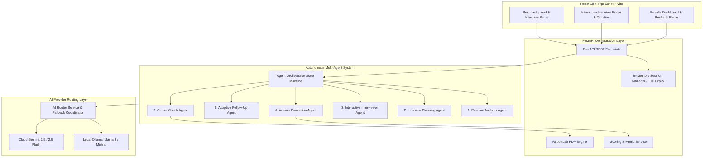

# InterviewReady AI — Autonomous Resume-Based Interview Preparation Agent


An Agentic AI application designed for students, freshers, and job seekers to prepare for technical interviews using actual evidence extracted from their resumes and target job descriptions.

---

## 1. Project Overview & Problem Statement

### The Problem
Traditional interview preparation platforms rely on static question banks, keyword flashcards, or non-grounded generic chatbots. These tools do not:
1. Verify the candidate's actual projects, architecture decisions, or claimed tech stacks.
2. Adapt dynamically with follow-up probing based on whether the candidate's answer was shallow or deep.
3. Provide objective, rubric-based scoring that separates correctness, relevance, clarity, and practical code design.

### The Solution: InterviewReady AI
**InterviewReady AI** is an autonomous multi-agent system that:
- **Parses Resumes** (PDF, DOCX, TXT) and matches claims against target Job Descriptions.
- **Plans Tailored Interviews** based on verified skills and project architectures.
- **Conducts Live Technical Interviews** with speech-to-text voice dictation or text answers.
- **Evaluates with Strict 4-Tier Rubrics** (Correctness 40%, Relevance 25%, Clarity 20%, Practical Application 15%).
- **Executes Adaptive Follow-Up Agents** to ask clarifying or deeper questions in real time.
- **Synthesizes a 3-Priority Career Roadmap** and generates a downloadable academic-grade PDF report using ReportLab.
- **Operates with Zero Database Dependencies** using secure in-memory TTL sessions.

---

## 2. Multi-Agent Architecture



---

## 3. Specialized AI Agents

| Agent Name | Core Responsibilities |
| :--- | :--- |
| **Resume Analysis Agent** | Extracts technical skills, frameworks, databases, projects, and claims directly from resume text. Never hallucinating skills. |
| **Job Match Agent** | Cross-references target JD against resume evidence into *Supported*, *Partial*, and *Missing* requirements. |
| **Interview Planner Agent** | Constructs a structured question progression matching candidate level, target role, difficulty, and project tech stack. |
| **Interviewer Agent** | Stages and delivers one question at a time with rationale and target competency criteria. |
| **Answer Evaluator Agent** | Assesses answers using a standardized 100-point rubric: Correctness (40), Relevance (25), Clarity (20), Practicality (15). |
| **Adaptive Follow-Up Agent** | Evaluates answer depth and dynamically decides whether to ask a clarifying question, drill deeper, request a practical code example, or advance topics. |
| **Career Coach Agent** | Synthesizes topic strengths and weak areas into a structured 3-priority improvement plan with study tasks and exercises. |

---

## 4. Technology Stack

### Frontend
- **Framework**: React 18, TypeScript, Vite
- **Styling**: Tailwind CSS, PostCSS, Custom Design System
- **Icons**: Lucide React
- **Visualizations**: Recharts (Radar charts & topic performance bar charts)
- **HTTP Client**: Axios
- **Speech Dictation**: Web Speech API integration

### Backend
- **Framework**: FastAPI (Python 3.11 / 3.14 compatible)
- **Server**: Uvicorn
- **Data Validation**: Pydantic v2 & Pydantic Settings
- **Document Parsing**: PyMuPDF (`pymupdf`) for searchable PDFs, `python-docx` for Word documents
- **PDF Generation**: ReportLab
- **AI Integrations**: Official `google-genai` / `google-generativeai` and HTTPX for local Ollama

### Storage & Security
- **In-Memory Session Manager**: Thread-safe memory store with configurable TTL expiration.
- **No Database**: Zero SQL or MongoDB requirements.
- **Safe File Deletion**: Temporary resume uploads are automatically sanitized and purged.

---

## 5. Folder Structure

```
c:\2nd MCA\ResumeAI/
├── backend/
│   ├── app/
│   │   ├── main.py                  # FastAPI Application Entrypoint & CORS
│   │   ├── config.py                # Pydantic Settings & Environment Config
│   │   ├── api/
│   │   │   ├── health.py            # Health and AI Provider Status Endpoints
│   │   │   ├── resume.py            # Upload, Extraction & JD Match Endpoints
│   │   │   ├── interview.py         # Session Lifecycle, Answering & Progress
│   │   │   └── report.py            # ReportLab PDF & JSON Export Routes
│   │   ├── agents/
│   │   │   ├── orchestrator.py      # State Machine Coordinator
│   │   │   ├── resume_agent.py      # Resume Analysis Agent
│   │   │   ├── interview_planner_agent.py # Tailored Question Planner
│   │   │   ├── interviewer_agent.py # Question Delivery Engine
│   │   │   ├── evaluator_agent.py   # Rubric-Based Answer Evaluator
│   │   │   ├── followup_agent.py    # Adaptive Branching Decision Agent
│   │   │   └── career_coach_agent.py# Roadmap Synthesis Agent
│   │   ├── services/
│   │   │   ├── ollama_service.py    # Local Ollama HTTP Client
│   │   │   ├── gemini_service.py    # Google GenAI SDK Adapter
│   │   │   ├── ai_router.py         # Hybrid / Provider Routing with Fallbacks
│   │   │   ├── resume_parser.py     # PDF, DOCX, TXT Parsing Engine
│   │   │   ├── scoring_service.py   # Performance Metric Aggregator
│   │   │   ├── session_manager.py   # In-Memory TTL Session Store
│   │   │   └── pdf_report_service.py# ReportLab PDF Generator
│   │   ├── models/
│   │   │   ├── schemas.py           # Pydantic API Request/Response Schemas
│   │   │   └── session.py           # Internal Session & State Schemas
│   │   ├── prompts/                 # Prompt Engineering Templates (.txt)
│   │   └── utils/
│   │       ├── file_validation.py   # MIME & Size Guardrails
│   │       └── json_parser.py       # Robust Markdown JSON Extractor
│   ├── tests/                       # Pytest Automated Test Suite
│   ├── requirements.txt             # Python Dependencies
│   ├── pytest.ini                   # Pytest Config
│   └── .env.example                 # Backend Environment Template
│
├── frontend/
│   ├── src/
│   │   ├── components/              # Modular UI Components (Navbar, Uploader, etc.)
│   │   ├── pages/                   # Home, SetupInterview, InterviewSession, Results
│   │   ├── services/api.ts          # Typed Axios Client
│   │   ├── types/index.ts           # Shared TypeScript Interfaces
│   │   ├── App.tsx                  # React Router Configuration
│   │   ├── main.tsx                 # React Root Mounting
│   │   └── index.css                # Tailwind CSS & Typography
│   ├── package.json                 # Frontend Dependencies
│   ├── vite.config.ts               # Vite Bundler Settings
│   └── .env.example                 # Frontend Environment Settings
│
└── README.md                        # Project Documentation
```

---

## 6. Quick Start & Execution Guide

### Prerequisites
1. **Python 3.11+** installed (`python --version`)
2. **Node.js 18+ & npm** installed (`node --version`)
3. *(Optional)* **Ollama** installed locally ([ollama.com](https://ollama.com)) with a model pulled (e.g., `ollama pull llama3`).
4. *(Optional)* A **Google Gemini API Key** from [Google AI Studio](https://aistudio.google.com/).

---

### Step 1: Backend Setup (PowerShell)

Open PowerShell in `c:\2nd MCA\ResumeAI`:

```powershell
# Navigate to backend
cd backend

# Create and activate virtual environment (if not already created)
python -m venv venv
.\venv\Scripts\Activate.ps1

# Install dependencies
pip install -r requirements.txt

# Create .env from template
copy .env.example .env

# (Optional) Edit backend/.env to add your GEMINI_API_KEY
# GEMINI_API_KEY=your_actual_key_here

# Run backend unit tests
python -m pytest -v

# Start FastAPI server on port 8000
python -m uvicorn app.main:app --host 0.0.0.0 --port 8000 --reload
```

Backend API Swagger Docs will be available at: **[http://localhost:8000/docs](http://localhost:8000/docs)**

---

### Step 2: Frontend Setup (Separate PowerShell Window)

Open a second PowerShell window in `c:\2nd MCA\ResumeAI`:

```powershell
# Navigate to frontend
cd frontend

# Install packages
npm install

# Start Vite development server
npm run dev
```

Frontend Application will be running at: **[http://localhost:5173](http://localhost:5173)**

---

## 7. AI Model Configuration Guide

### Option A: Local Ollama Only (100% Offline & Private)
1. Install Ollama and start the service: `ollama serve`
2. Download your preferred model: `ollama pull llama3` or `ollama pull mistral`
3. In `backend/.env`:
   ```env
   DEFAULT_AI_PROVIDER=ollama
   OLLAMA_BASE_URL=http://localhost:11434
   OLLAMA_MODEL=llama3
   ```

### Option B: Google Gemini API (Cloud)
1. Obtain an API key from Google AI Studio.
2. In `backend/.env`:
   ```env
   DEFAULT_AI_PROVIDER=gemini
   GEMINI_API_KEY=AIzaSy...
   GEMINI_MODEL=gemini-1.5-flash
   ```

### Option C: Smart Hybrid Mode (Recommended)
1. In `backend/.env`:
   ```env
   DEFAULT_AI_PROVIDER=hybrid
   ```
2. In Hybrid Mode:
   - **Resume Extraction & Question Planning**: Handled locally via Ollama.
   - **Answer Evaluation & Career Coaching**: Elevated to Gemini for deep reasoning, or fallen back to Ollama if offline.

---

## 8. MCA Project Demonstration Guide & Viva Q&A

### Key Demonstration Highlights
1. **Live Resume Upload**: Upload any PDF/DOCX resume and show real-time extraction of programming languages, frameworks, and projects without hallucinations.
2. **Job Description Matching**: Paste a sample Job Description and show how skills are automatically categorized into Supported, Partial, and Missing.
3. **Adaptive Follow-Up in Action**: Answer a question partially; observe the Agent generate a context-aware follow-up question.
4. **Voice Dictation**: Use the microphone dictation button to demonstrate speech-to-text input.
5. **ReportLab PDF Download**: Generate and open the comprehensive PDF performance report.

### Sample Viva Questions & Answers

**Q1: What makes InterviewReady AI an "Agentic AI" rather than a regular chatbot?**  
*Answer:* A simple chatbot responds to prompts with unstructured text. InterviewReady AI utilizes an autonomous state machine coordinator (`AgentOrchestrator`) that manages distinct agents (`Resume Analysis`, `Planner`, `Interviewer`, `Evaluator`, `Follow-Up`, `Career Coach`). Decisions are structured JSON objects with state tracking, budget limits, and adaptive decision branches based on rubric evaluations.

**Q2: How does the system prevent hallucinations about candidate skills?**  
*Answer:* The Resume Analysis prompt enforces strict evidence extraction requiring direct quotes/locations from the uploaded resume. Furthermore, the planner prompt explicitly instructs the agent to never assume a candidate possesses a skill solely because it appeared in a job description.

**Q3: How does the application store interview sessions without a database?**  
*Answer:* Sessions are maintained in-memory using a thread-safe `SessionManager` indexed by UUIDv4 keys with configurable TTL expiration (`INTERVIEW_SESSION_TTL_MINUTES=120`). Uploaded resume files are placed in a temporary folder and automatically purged upon completion or session deletion.

**Q4: How does the 4-tier rubric evaluation work?**  
*Answer:* Answers are evaluated against 4 weighted criteria:
1. Technical Correctness (0–40 pts)
2. Relevance to Question (0–25 pts)
3. Explanation and Clarity (0–20 pts)
4. Practical Application / Code Examples (0–15 pts)  
The system validates and enforces that the total composite score matches the sum of these four components.

---

## 9. License & Academic Disclaimer

This project is created for **MCA Academic Project Demonstration** purposes. The evaluation scores and benchmark answers provided by the AI models are automated estimates designed to assist candidates with self-assessment and technical interview preparation.
